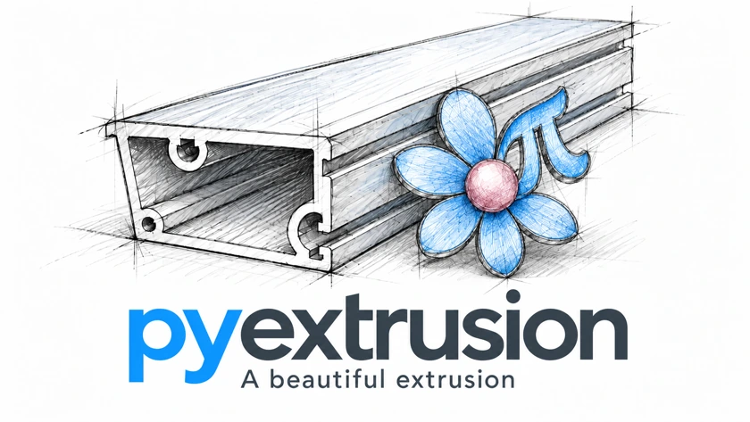

<section class="px-hero px-shell" aria-labelledby="engineering-aluminium-extrusion">
  <div class="px-hero__copy">
    <p class="px-eyebrow"><span class="px-dot" aria-hidden="true"></span> PYTHON LIBRARY · ALUMINIUM EXTRUSION</p>
    <h1 id="engineering-aluminium-extrusion">Engineering<br>Aluminium<br><span>Extrusion.</span></h1>
    <p class="px-lead">From the billet to the production plan.<br>Engineering calculations for the people<br class="px-desktop-break"> who know what goes into an extrusion.</p>
    <div class="px-actions">
      <a class="px-button px-button--primary" href="user-guide/getting-started/">Get started <span aria-hidden="true">↗</span></a>
      <a class="px-button px-button--secondary" href="https://github.com/enrique-co/pyextrusion">Explore GitHub <span aria-hidden="true">↗</span></a>
    </div>
    <p class="px-hero__meta"><span>v0.19.0</span><span>Python ≥ 3.10</span><span>Apache-2.0</span></p>
  </div>
  <figure class="px-hero__art">
    <div class="px-figure-label"><span>THE ART OF EXTRUSION</span><span aria-hidden="true">01 /</span></div>
    
    <figcaption><span>Precision in the calculation.</span><span>Beauty in the extrusion.</span></figcaption>
  </figure>
</section>

<div class="px-route-strip">
  <nav class="px-shell" aria-label="Documentation sections">
    <span class="px-route-strip__label">EXPLORE THE LIBRARY</span>
    <a href="user-guide/">User Guide <span aria-hidden="true">↗</span></a>
    <a href="engineering/">Engineering <span aria-hidden="true">↗</span></a>
    <a href="technical-reference/">Technical Reference <span aria-hidden="true">↗</span></a>
    <a href="api-reference/">API Reference <span aria-hidden="true">↗</span></a>
    <a href="examples/">Examples <span aria-hidden="true">↗</span></a>
  </nav>
</div>

<section class="px-section px-shell" id="capabilities" aria-labelledby="capabilities-title">
  <div class="px-section-heading">
    <div><p class="px-eyebrow">THREE WORKING AREAS</p><h2 id="capabilities-title">One process.<br>Connected perspectives.</h2></div>
    <p>Plan the production. Explore the engineering.<br>Understand the economics.<br>One consistent Python toolkit.</p>
  </div>
  <div class="px-areas">
    <article class="px-area">
      <div class="px-area__top"><svg viewBox="0 0 40 40" fill="none" stroke="currentColor" stroke-width="1.5" aria-hidden="true"><path d="M6 13 20 6l14 7v16l-14 7-14-7V13Z M6 13l14 7 14-7M20 20v16M13 9.5l14 7v8l-7 3.5"/></svg><span>01</span></div>
      <h3>Production <span>&amp; Planning</span></h3>
      <p>Turn press, profile and process inputs into billet sizing, production quantities and technical press time.</p>
      <ul><li>Geometry &amp; productivity</li><li>Multi-billet configurations</li><li>Sequences &amp; press comparison</li></ul>
      <a class="px-text-link" href="user-guide/">Plan a production <span aria-hidden="true">↗</span></a>
    </article>
    <article class="px-area">
      <div class="px-area__top"><svg viewBox="0 0 40 40" fill="none" stroke="currentColor" stroke-width="1.5" aria-hidden="true"><path d="M7 5v28h29M11 28c6 0 5-13 11-13s5 8 12-8M12 9h6M26 28h6"/><circle cx="22" cy="15" r="2.5" fill="white"/></svg><span>02</span></div>
      <h3>Engineering</h3>
      <p>Explore source-traced material models and analytical mechanical and thermal tools, with explicit model boundaries.</p>
      <ul><li>AA6060 / AA6063 rheology</li><li>Axisymmetric pressure baseline</li><li>Bounded thermal estimates</li></ul>
      <a class="px-text-link" href="engineering/">Explore the models <span aria-hidden="true">↗</span></a>
    </article>
    <article class="px-area">
      <div class="px-area__top"><svg viewBox="0 0 40 40" fill="none" stroke="currentColor" stroke-width="1.5" aria-hidden="true"><path d="M7 33V22h6v11M17 33V15h6v18M27 33V7h6v26M5 33h31M8 14l12-7 5 2 8-6"/></svg><span>03</span></div>
      <h3>Economics</h3>
      <p>Connect production results to costs and margins using assumptions you supply and can inspect.</p>
      <ul><li>Material &amp; scrap economics</li><li>Production &amp; tooling costs</li><li>Sales margins</li></ul>
      <a class="px-text-link" href="user-guide/basic-economics/">Understand the costs <span aria-hidden="true">↗</span></a>
    </article>
  </div>
</section>

<section class="px-philosophy" aria-labelledby="philosophy-title">
  <div class="px-shell px-philosophy__grid">
    <div>
      <p class="px-eyebrow">ENGINEERING PHILOSOPHY</p>
      <h2 id="philosophy-title">Real constraints.<br><span>Transparent calculations.</span></h2>
      <p class="px-philosophy__intro">An extrusion is more than an extrusion ratio. The useful answer also depends on the press, the billet, the cuts and the time between them.</p>
      <a class="px-text-link" href="user-guide/model-boundaries/">Read the model boundaries <span aria-hidden="true">↗</span></a>
    </div>
    <div class="px-principles">
      <div><span>01 /</span><div><h3>Deterministic by design</h3><p>The same inputs produce the same results. Calculations follow explicit rules and caller-supplied assumptions.</p></div></div>
      <div><span>02 /</span><div><h3>Traceable from input to result</h3><p>Inspect units, applied defaults, process choices and warnings. Know what each result represents.</p></div></div>
      <div><span>03 /</span><div><h3>Clear about the limits</h3><p>Pressure is an axisymmetric screening baseline. Thermal tools are bounded estimates. Industrial judgement remains essential.</p></div></div>
    </div>
  </div>
</section>

<section class="px-section px-shell" id="example" aria-labelledby="example-title">
  <div class="px-section-heading">
    <div><p class="px-eyebrow">FROM INPUT TO INSIGHT</p><h2 id="example-title">300 bars.<br>A complete production picture.</h2></div>
    <p>A worked example from the User Guide.<br>Calculated with PyExtrusion 0.19.0.<br>Rounded here for readability.</p>
  </div>
  <div class="px-scenario">
    <div class="px-scenario__inputs">
      <p class="px-eyebrow">01 / PROCESS INPUTS</p>
      <dl><div><dt>Nominal press / table</dt><dd>8″ / 54 m</dd></div><div><dt>Solid profile / die exits</dt><dd>1.35 kg/m / 2</dd></div><div><dt>Exit speed</dt><dd>24 m/min</dd></div><div><dt>Commercial cut length</dt><dd>7,000 mm</dd></div><div><dt>Total trim per billet</dt><dd>2 m</dd></div><div><dt>Production target</dt><dd>300 bars</dd></div></dl>
      <p class="px-small">Normal complexity. Default nominal-press geometry, saw kerfs, butt rule and dead time apply.</p>
    </div>
    <div class="px-scenario__results">
      <p class="px-eyebrow">02 / CALCULATED PLAN <span class="px-result-status">Target fulfilled</span></p>
      <div class="px-metrics"><div><strong data-result="planned_billets">30</strong><span>complete billets</span></div><div><strong data-result="planned_bars">300</strong><span>finished bars</span></div><div><strong data-result="planned_good_kg">2,835 <small>kg</small></strong><span>good production</span></div><div><strong data-result="time_used_min">53.54 <small>min</small></strong><span>technical press time</span></div></div>
      <p class="px-small">Technical time includes extrusion and modelled dead time between billets. It is not a full shift or delivery-time forecast.</p>
      <a class="px-text-link" href="user-guide/getting-started/#first-complete-example">See the complete example &amp; assumptions <span aria-hidden="true">↗</span></a>
    </div>
  </div>
  <details class="px-example-code">
    <summary>Inspect the Python behind this result <span aria-hidden="true">+</span></summary>
    <div class="px-code" markdown="1">

```python
from pyextrusion import (
    Press, Profile, Process, PlanningCase,
    PlanningRequest, calculate_planning,
)

press = Press(
    name="Example 8-inch press", nominal_size_in=8, table_length_m=54,
)
case = PlanningCase(
    profile=Profile(linear_weight_kg_m=1.35, exits=2, profile_type="solid"),
    process=Process(
        exit_speed_m_min=24, cut_length_mm=7000,
        trim_total_per_billet_m=2, complexity="normal",
    ),
)
plan = calculate_planning(press, case, PlanningRequest.bars(300))

print(plan.planned_billets)  # 30
print(plan.planned_bars)     # 300
print(plan.planned_good_kg)  # 2835.0
print(round(plan.time_used_min, 2))  # 53.54
```

    </div>
  </details>
</section>

<section class="px-get-started" aria-labelledby="start-title">
  <div class="px-shell px-get-started__grid">
    <div><p class="px-eyebrow">DESIGNED FOR PYTHON. BUILT FOR EXTRUSION.</p><h2 id="start-title">Put the engineering<br>into your workflow.</h2><p>Use the Python API in your applications and analysis tools,<br class="px-desktop-break"> or work with the JSON and command-line interfaces.</p><a class="px-text-link" href="user-guide/getting-started/">Your first calculation <span aria-hidden="true">↗</span></a></div>
    <div class="px-terminal">
      <div class="px-terminal__bar"><span><i></i><i></i><i></i></span><span>INSTALL · PYTHON ≥ 3.10</span></div>
      <div class="px-install"><span aria-hidden="true">$</span><code id="px-install-command">pip install pyextrusion==0.19.0</code><button type="button" class="px-copy" data-copy="px-install-command" aria-label="Copy installation command"><svg viewBox="0 0 24 24" fill="none" stroke="currentColor" stroke-width="1.5" aria-hidden="true"><rect x="8" y="8" width="12" height="13" rx="2"/><path d="M16 8V3H3v13h5"/></svg></button></div>
      <p id="px-copy-status" class="px-copy-status" role="status" aria-live="polite">Ready for your next calculation.</p>
      <div class="px-terminal__links"><a href="api-reference/python-api/">Python API ↗</a><a href="api-reference/json/">JSON ↗</a><a href="api-reference/cli/">CLI ↗</a></div>
    </div>
  </div>
</section>

<section class="px-resources px-shell" aria-labelledby="resources-title">
  <div class="px-resources__intro"><div><p class="px-eyebrow">KEEP EXPLORING</p><h2 id="resources-title">The detail is in the documentation.</h2></div></div>
  <div class="px-resource-links"><a href="user-guide/"><span>Learn the workflow</span><strong>User Guide <span aria-hidden="true">↗</span></strong></a><a href="technical-reference/"><span>Understand the calculations</span><strong>Technical Reference <span aria-hidden="true">↗</span></strong></a><a href="api-reference/"><span>Build your integration</span><strong>API Reference <span aria-hidden="true">↗</span></strong></a><a href="examples/"><span>Start from a working pattern</span><strong>Examples <span aria-hidden="true">↗</span></strong></a></div>
  <p class="px-release-note"><strong>Updating an existing project?</strong> v0.19.0 introduces canonical total trim per incoming billet. Review <a href="user-guide/trim-topology/">trim topology &amp; legacy migration</a> and <a href="technical-reference/geometry/#physical-butt-and-equivalent-incoming-billet-length">physical butt geometry</a> before reusing older inputs.</p>
</section>
